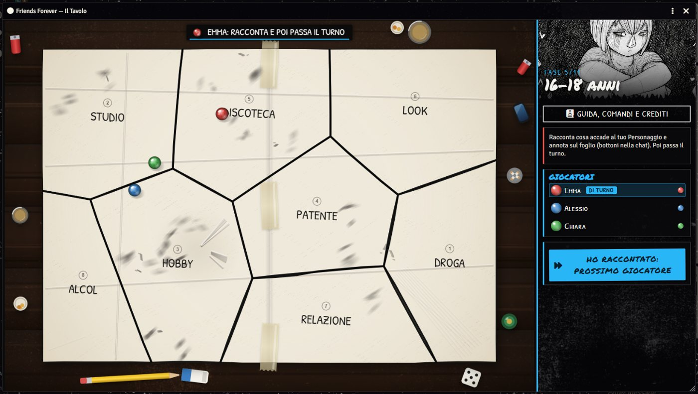
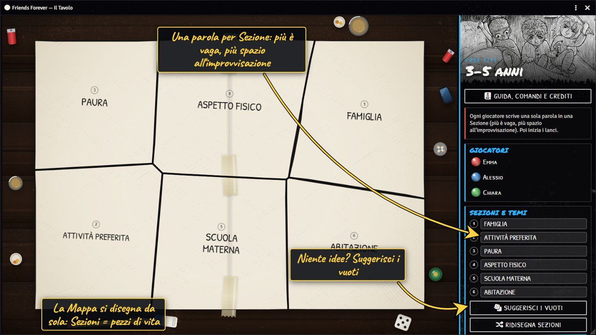
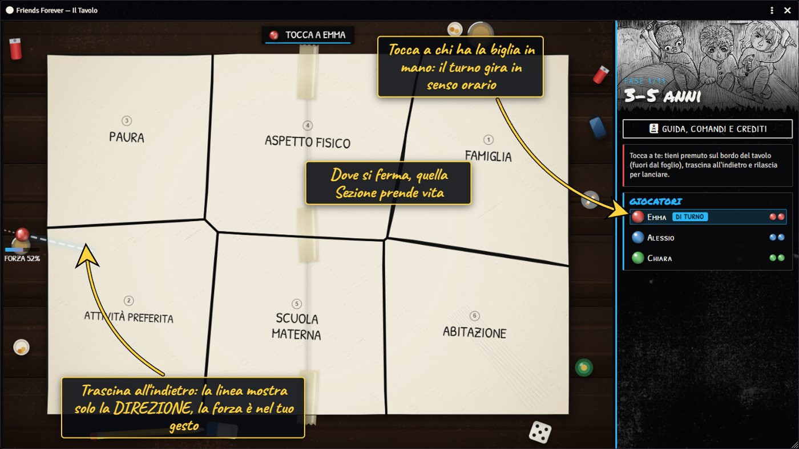
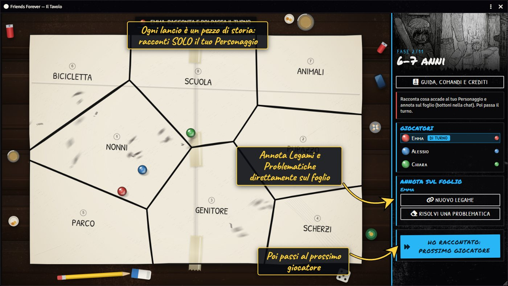
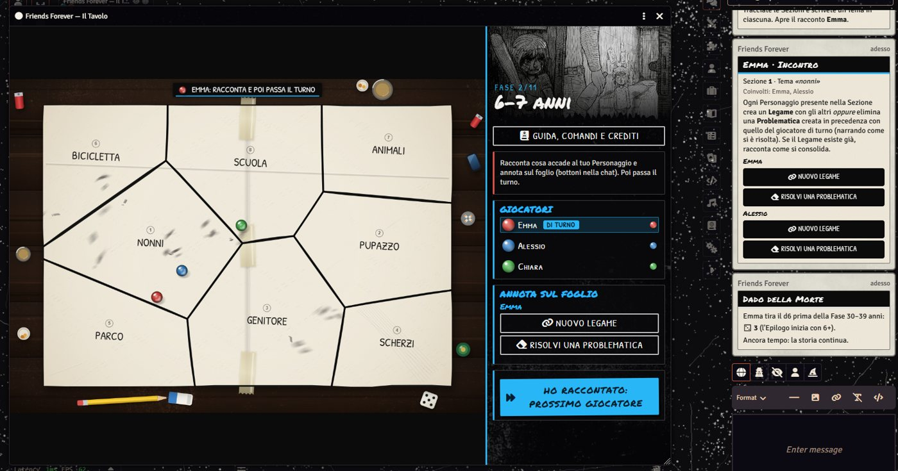
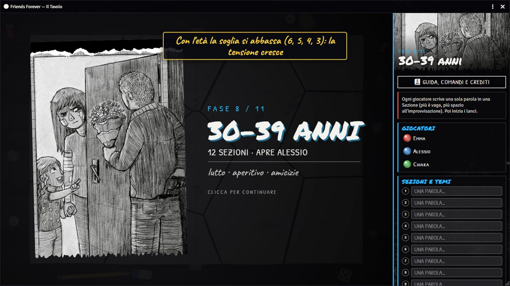
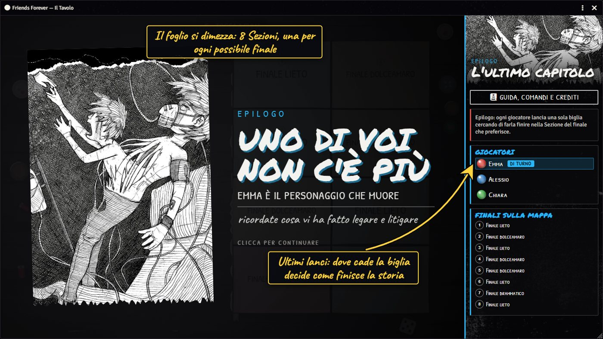
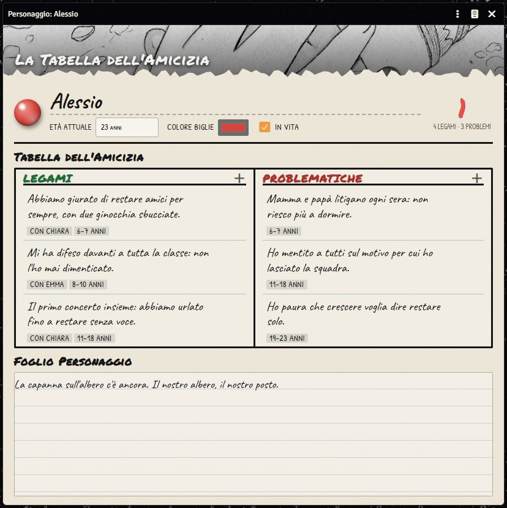

# Friends Forever per Foundry VTT

Sistema **non ufficiale** per giocare a *Friends Forever* (GDR masterless sull'amicizia, di Elisa Lo Porto) da remoto su
[Foundry VTT](https://foundryvtt.com) (v13+, verificato su 14.369).

> Il gioco, il nome, i testi e le illustrazioni appartengono ai rispettivi autori. Questo repository contiene solo il
> codice del sistema (MIT). Le **illustrazioni** (cartella `assets/ff-art`) sono di **Jioke** e appartengono ai loro autori
> (Elisa Lo Porto, Officina Meningi): sono incluse solo per rendere il sistema giocabile, **non sono coperte dalla licenza MIT**
> e non vanno riutilizzate altrove. Se sei un titolare dei diritti e vuoi che vengano rimosse, scrivi a michael.guidotti@latavernadiguido.it.

<p align="center"></p>

## Anteprima

| | |
|---|---|
|  **I Temi**: una parola per Sezione |  **Il lancio**: trascina e rilascia la biglia |
|  **Racconto e annotazioni** |  **Card in chat** per ogni esito |
|  **Dado della Morte** |  **Epilogo** con 8 finali |
|  **Scheda** con la Tabella dell'Amicizia | |

## Cosa c'è

- **Il Tavolo** — la finestra di gioco: un foglio di carta (la Mappa) su un tavolo di legno, con le **biglie** che rotolano con
  fisica vera (attrito, urti, rimbalzi su bicchieri e ciotole), le **Sezioni** con i Temi scritti a mano e, fase dopo fase,
  le **macchie e le pieghe** delle cancellature che rendono i lanci sempre più imprevedibili.
- **Flusso completo del regolamento**: le 11 Fasi (3–60 anni) con il numero di Sezioni giusto, turni in senso orario con 2 o 3
  biglie a testa, tutti gli esiti del Movimento (Legame, Problematica, Scontro, Indistruttibili, solco tra due Sezioni),
  Dado della Morte, Epilogo con metà foglio strappata e finali lieto/dolceamaro/drammatico/tragico.
- **Schede**: Foglio Personaggio con la **Tabella dell'Amicizia** (Legami / Problematiche); le voci Indistruttibili sono
  sottolineate, valgono doppio e non si possono rimuovere.
- **Chat**: ogni lancio produce una card con l'esito e i bottoni per annotare Legami e Problematiche sul foglio giusto.
- **Varianti**: sessione dimostrativa (3 Fasi) e **modalità in solitario** (3 PNG, Temi dalle Tabelle del Solitario,
  posizionamento dei PNG col dado).
- Contenuti nel mondo: riepilogo delle regole, sicurezza e consenso, tabelle degli spunti e del solitario, macro.

## Installazione

Serve **Foundry VTT v13 o v14** (verificato su 14.369).

**Metodo consigliato (manifesto):**

1. In Foundry apri la scheda **Game Systems** e premi **Install System**.
2. In fondo, nel campo **Manifest URL**, incolla:

   ```
   https://github.com/guido92/friends-forever-foundry/releases/latest/download/system.json
   ```

3. Premi **Install**. Il sistema compare come *Friends Forever*.
4. Crea un nuovo **World** scegliendo il sistema *Friends Forever* e avvialo.

**Metodo manuale:** scarica `friends-forever-v0.1.4.zip` dalla pagina [Releases](https://github.com/guido92/friends-forever-foundry/releases),
estrailo in `Data/systems/friends-forever/` (la cartella deve contenere direttamente `system.json`) e riavvia Foundry.

**Aggiornare:** dalla scheda *Game Systems* premi *Update* sul sistema.

### Illustrazioni

Sono già incluse nel sistema, non devi fare nulla. Se vuoi rigenerarle dal tuo PDF del gioco (`tools/extract-art.py`):

```bash
pip install pymupdf pillow
python tools/extract-art.py "percorso/del/Friends Forever.pdf"
```

### Problemi?

Dal gioco apri **Guida → Assistenza** (mail già compilata) oppure scrivi a michael.guidotti@latavernadiguido.it,
o apri una [issue](https://github.com/guido92/friends-forever-foundry/issues).

## Come si gioca

1. Crea un mondo con il sistema *Friends Forever* e un **Personaggio** per ogni giocatore (assegnagli la proprietà).
2. Apri **Il Tavolo**: bottone in cima alla chat, controllo scena (cerchio), macro, oppure <kbd>Alt</kbd>+<kbd>T</kbd>.
3. Il GM sceglie *Nuova partita*: giocatori, Personaggi, gruppo/solitario, dimostrativa, disordine sul tavolo.
4. Scrivete un Tema per Sezione, poi **Inizia i lanci**. Per lanciare: tieni premuto sul bordo del tavolo (fuori dal foglio),
   trascina all'indietro e rilascia (come una fionda). Racconta, annota dai bottoni in chat, passa il turno.

Serve un GM connesso: la partita vive nello stato del mondo e il GM valida i tiri.

## Sviluppo

```bash
npm test          # test di fisica, regole e flusso (Node, nessuna dipendenza)
npm run build     # crea dist/friends-forever-v<versione>.zip e dist/system.json
```

Il codice è diviso così:

| Cartella | Contenuto |
|---|---|
| `module/core` | geometria, fisica delle biglie, regole pure (testate con Node) |
| `module/game` | motore a stati (`engine.mjs`), chat, collante Foundry (socket + stato del mondo) |
| `module/apps` | il Tavolo (canvas), dialoghi di setup e di annotazione |
| `module/sheets`, `module/documents` | schede e data model |
| `module/data` | spunti e Tabelle del Solitario |

Per sviluppare in locale collega la cartella a Foundry con una *junction*:

```powershell
New-Item -ItemType Junction -Path "$env:LOCALAPPDATA\FoundryVTT\Data\systems\friends-forever" -Target (Get-Location)
```

Riavvia Foundry la prima volta (rilegge `Data/systems`); poi basta ricaricare il mondo.

## Rilascio

Il workflow di rilascio è in `docs/release-workflow.yml` (il token di `gh` non aveva lo scope `workflow`: dopo `gh auth refresh -s workflow` copialo in `.github/workflows/release.yml`).
Pubblica un tag `vX.Y.Z`: la GitHub Action lancia i test, costruisce lo zip e carica
`system.json` + zip nella release, con gli URL di manifesto e download già valorizzati.
